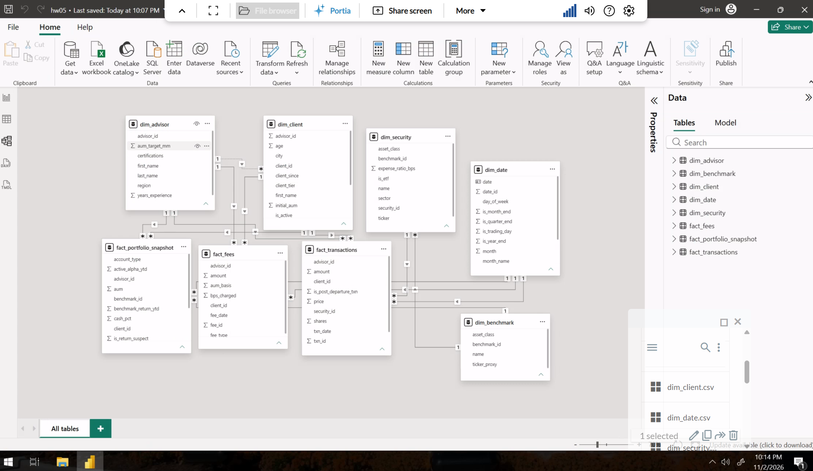
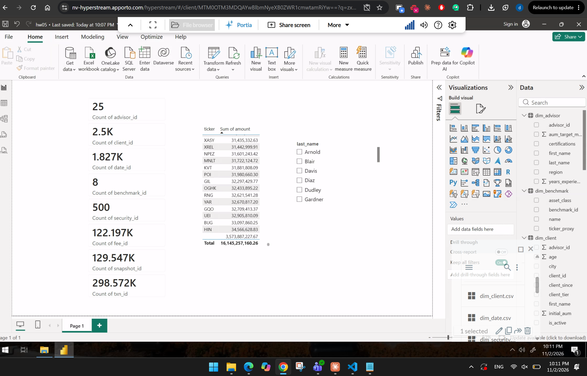

# HW5 — Wildcat Capital Star Schema in Power BI
MIS3060 Business Intelligence with AI | Villanova University

This assignment models the eight clean Wildcat Capital tables as a star schema. It identifies keys, grain and measure types, proves them in Python, and builds the model in Power BI Desktop.

## Folder structure

```
hw05/
├── README.md            this file
├── star_design.md       Parts A, B, C, E and F (keys, grain, measures, design questions, reflection)
├── hw05_checks.py       Python checks that prove the keys, grain and measure claims (55 checks)
├── All checks passed.png            screenshot of the check script's VS Code run
└── powerbi/
    ├── hw05.pbix                    Part D: the Power BI model (8 tables, 13 relationships, date table marked)
    ├── model_view.png               Part D: Model view screenshot
    └── powerbimodel_view.png        report page with the row-count cards, blank test and advisor slicer
```

The eight CSVs (`Wildcat Capital Clean/`) are course data and are not committed to the repo.

## How to run the checks

Requirements: Python 3 with `pandas` (`pip install pandas`).

```
# with the script in the same folder as the eight CSVs
python hw05_checks.py

# or point it at the data folder
python hw05_checks.py "path/to/Wildcat Capital Clean"
```

The script prints one PASS/FAIL line per check, grouped into five sections, and exits with code 1 if any check fails:

1. Row and column counts match the handout, and the required columns exist
2. Primary keys are unique, non-blank whole numbers (Part A)
3. Foreign keys have no orphans; blank `security_id` occurs on exactly the cash rows; each fact's `advisor_id` matches `dim_client` (Part A, Part E)
4. Grain: one row per client per month for fees and snapshots; no duplicate rows and no natural key in transactions (Part B)
5. Measure arithmetic behind the additive / semi-additive / non-additive classifications (Part C)

**Result (run in VS Code on November 2, 2026):** all 55 checks passed. See the screenshot of the run below.


## Power BI model (Part D)

- 8 tables loaded with types set in Power Query (keys Whole Number, dates Date, amounts Decimal, `zip_code` and `account_type` Text)
- 12 active relationships and 1 inactive one (`dim_client` → `dim_advisor`), all many-to-one with single-direction filtering
- Fact dates are joined to `dim_date[date]`, not `date_id`; `dim_date` is marked as the date table
- Row-count cards match the handout for all eight tables; one `(Blank)` ticker row (cash transactions, 3,573,887,227.67); the transactions total of 16,145,257,160.26 matches the CSV; the advisor slicer filters all three facts

**Model view** (`powerbi/model_view.png`). The dashed line from `dim_client` to `dim_advisor` is the inactive relationship:



**Model checks** (`powerbi/powerbimodel_view.png`): the row-count cards, the `dim_security[ticker]` × `fact_transactions[amount]` table with its one blank row, and the advisor slicer:



## Claude Code findings

Claude Code reviewed the first version of `hw05_checks.py` (41 checks). It found no errors in the conclusions, but several checks could have passed on bad data. All findings were fixed, and the script was tested against a deliberately corrupted copy of the data (a duplicated row, a Deposit with a security, a Buy with no shares); each problem was caught.

| Finding | Fix |
|---|---|
| The shares × price check selected rows by "shares is filled", so a trade missing shares would be skipped | Trade rows are selected by `txn_type`, with a new check that shares and price are never blank on them |
| The "no natural key" check would pass on double-loaded data | Added a check that no two rows are identical apart from `txn_id`. The natural-key test now uses only trade rows (94 repeats, not 622, because 528 of the 622 relied on pandas treating two blanks as equal, which SQL and Power BI do not) |
| The blank `security_id` check only went one way | Now checks both ways: every cash row is blank and every trade row has a security |
| The "fact dates are calendar dates" check covered only `fact_fees` and half of it could never fail | Removed; the three date foreign-key checks already prove it |
| Tolerances of $0.05 were 10× looser than needed | Tightened to $0.01 (the largest real gap is $0.005, rounding to the cent) |
| The fee-to-snapshot match relied on a row count | Uses `merge(validate="one_to_one", indicator=True)` |
| A key stored as text would pass the non-blank test | Primary keys must also be a whole-number type |
| A missing column crashed the script | Prints a FAIL line and stops cleanly |

## Notes on the data

- `dim_client[zip_code]` was stored as a number in the clean CSV, so leading zeros were already lost (e.g. `3897` should be `03897`). It is loaded as Text in Power BI so no further damage occurs, but the zeros cannot be recovered from this file.
- Monthly snapshots and fees are dated the 1st of the month, while `dim_date`'s `is_month_end` / `is_quarter_end` / `is_year_end` flags mark the last day, so those flags never match a snapshot (see Part F).
- `return_ytd` contains extreme values (up to 9,467%); 3,875 rows are flagged `is_return_suspect`.
